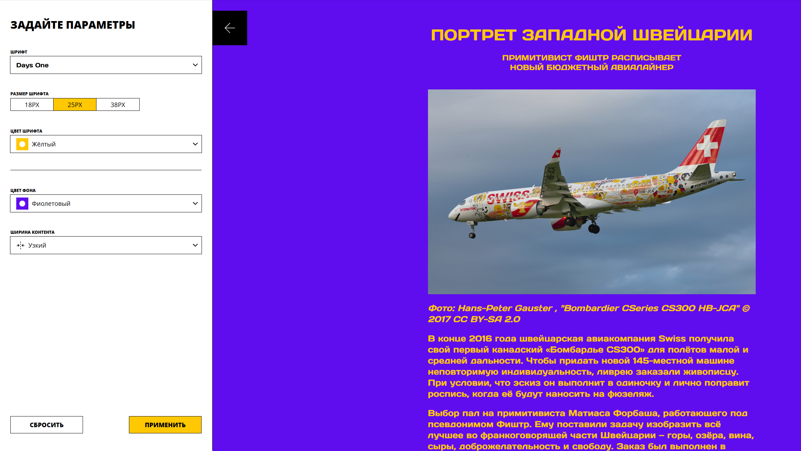

# Проект "Кастомизируемый блог" от Яндекс Практикум

## Оглавление

- [Цель проекта](#Цель)
- [Стек](#Стек)
- [Запуск проекта](#Запуск)
- [Скриншот](#скриншот)
- [Макет](#макет)
- [Автор](#автор)
- [Ссылки](#ссылки)
- [Автор](#автор)
- [Благодарность](#благодарность)

### Цель проекта

Реализовать кастомизацию страницы блога через открывающуюся панель.

### Стек

- TypeScript
- JavaScript
- HTML
- SCSS
- Webpack
- Storybook

### Запуск проекта

Для запуска Storybook выполните:

```
npm run storybook
```

Для запуска линтера для стилей выполните:

```
npm run stylelint
```

Для запуска линтера выполните:

```
npm run lint
```

Для запуска форматтера выполните:

```
npm run format
```
Для запуска Проекта выполните:

```
npm run start
```

### Скриншот



### Макет

- Макет задания: [Figma](https://www.figma.com/design/FEeiiGLOsE7ktXbPpBxYoD/Custom-dropdown?node-id=0-1&p=f&t=JmBkOimbBdfcbo6C-0)

### Ссылки

- URL решения: [Github](https://github.com/just01soul/blog-customizer.git)

## Автор

- Github - [Александр Христофоров](https://github.com/just01soul)

## Благодарность

Выражаю благодарность команде Яндекс Практикум за предоставление дизайна и уроков!
